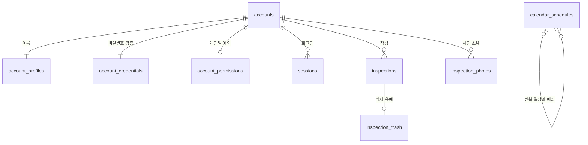

# FM 파트너스 서버 데이터 구조 · v0.99927

계정은 **누구인지**, 로그인 인증정보는 **비밀번호를 검증할 자료**, 권한은 **무엇을 할 수 있는지**로 나누었습니다. 점검·현장·사진·일정은 기존의 별도 테이블을 유지합니다.

| 구역 | 테이블 | 보관하는 내용 |
| --- | --- | --- |
| 계정 | `accounts` | 고유 계정번호, 아이디, 어드민·관리자·점검자 등급, 사용 중지·삭제 상태 |
| 이름 | `account_profiles` | 암호화된 이름, 정보 버전 |
| 비밀번호 | `account_credentials` | 비밀번호 해시, 첫 로그인 변경 여부, 임시 비밀번호 만료 시각 |
| 개인별 권한 | `account_permissions` | 등급 기본값을 따를지, 개인별로 허용·차단할지, 권한 변경 버전 |
| 로그인 유지 | `sessions` | 로그인 토큰의 해시, 계정번호, 만료 시각 |
| 로그인 제한 | `login_attempts` | 재시도 제한 횟수와 해제 시각 |
| 현장 | `sites` | 암호화된 현장 정보, 수정 버전, 사용 중지 여부를 포함한 저장 내용 |
| 점검표 | `inspections` | 작성자 계정번호, 암호화된 점검 내용, 수정 버전, 삭제 표시 |
| 사진 | `inspection_photos` | 작성자·점검표·사진 번호, 암호화된 사진, 용량, 전송 대기 상태 |
| 삭제 유예 | `inspection_trash` | 복원 기한이 남은 삭제 점검표, 복원 기한 |
| 일정 | `calendar_schedules` | 날짜, 반복 규칙, 원본 반복 일정 연결, 암호화된 일정 내용, 수정 버전 |
| 기본 이력 | `audit` | 누가 언제 어떤 작업을 했는지 |
| 상세 이력 | `owner_actions` | 어드민이 확인하는 암호화된 변경 전후 내용 |
| 최초 설정 | `installation` | 최초 어드민 설정 완료 여부 |

`photos`는 초기 R2 방식의 흔적입니다. 현재 사진 저장은 `inspection_photos`를 사용합니다. 기존 데이터 보호를 위해 이번 변경에서 옛 테이블을 삭제하지 않습니다.



사진의 `record_id`는 점검표를 가리키지만 DB 외래키로 묶지는 않습니다. **사진 전송을 먼저 완료한 뒤 점검표를 저장하는 기존 순서**를 유지하기 위해서입니다. 서버가 소유권과 점검표 연결을 검증합니다. 현장 정보도 점검 당시의 내용을 별도로 보관하여 현장 수정이 과거 점검표를 바꾸지 않도록 합니다.

## 저장과 조회 흐름

1. 아이디로 계정을 찾고, `account_credentials`에서 비밀번호를 검증합니다.
2. `account_profiles`에서 이름을 읽고, 등급과 `account_permissions`를 합쳐 실제 권한을 계산합니다.
3. 로그인하면 `sessions`에 로그인 유지 정보를 기록합니다. 원래 토큰이나 원문 비밀번호는 저장하지 않습니다.
4. 점검 내용과 사진은 각각의 테이블에 암호화해 저장합니다. 같은 점검을 동시에 수정하면 버전 검사를 거칩니다.
5. 삭제·권한 변경 등은 기존 변경이력에 남습니다.

## 기존 데이터 이전

새 파일은 `server/migrations/0006_account_storage.sql`입니다. 기존 이름의 암호문과 비밀번호 해시를 **그대로 복사**하므로 비밀번호 재설정이나 재가입이 필요하지 않습니다. 계정번호·점검번호·사진번호도 바꾸지 않습니다.

기존 `accounts`의 이름·비밀번호 관련 열은 **구버전 호환용 복사본**으로 남깁니다. 새 서버는 분리된 테이블에서 이름을 조회하고 비밀번호 검증정보를 관리하며, SQL 트리거가 호환용 열을 동기화합니다. 앱에서는 이름과 아이디를 변경할 수 없습니다. 배포 중 기존 서버가 계속 실행되거나 이전 서버 버전으로 돌아가더라도 같은 이름·비밀번호를 사용하기 위한 조치입니다. 옛 열을 별도로 수정하거나 지울 필요가 없습니다.

GitHub 자동 배포의 기존 순서는 **백업 → 미적용 SQL 이전 → 새 서버 배포**입니다. 이번 변경은 그 순서를 그대로 사용합니다. 운영 DB에 자동 적용되는 시점은 `main` 반영 후 배포 작업이 실행될 때입니다.

## 조회 성능과 확인 방법

로그인 만료 정리, 최근 점검 조회, 계정별 이력, 사진 연결 조회에 필요한 색인을 추가했습니다. 화면과 API의 기존 권한 규칙은 변경하지 않습니다.

Cloudflare D1 콘솔에서 아래 조회로 이전 상태를 확인할 수 있습니다. 이름이나 비밀번호 값을 꺼내지 않고 수량만 비교합니다.

```sql
SELECT 'accounts' AS table_name, COUNT(*) AS row_count FROM accounts
UNION ALL SELECT 'account_profiles', COUNT(*) FROM account_profiles
UNION ALL SELECT 'account_credentials', COUNT(*) FROM account_credentials;

PRAGMA foreign_key_check;
```

첫 조회의 세 수량은 같아야 합니다. 외래키 검사 결과는 비어 있어야 합니다. 계정별 권한은 기본값을 따르는 계정의 행이 없을 수 있어 계정 수량과 같을 필요가 없습니다.

검증은 기존 데이터 이전, 암호문·해시 보존, 구·신 서버 쓰기 호환, 외래키, 로그인·권한·사진·일정, 실제 Wrangler 로컬 이전과 SQL 백업 복원을 포함합니다. 운영 서버의 계정·기록을 시험 데이터로 사용하지 않았습니다.

[Cloudflare D1 데이터 이전 안내](https://developers.cloudflare.com/d1/reference/migrations/)
